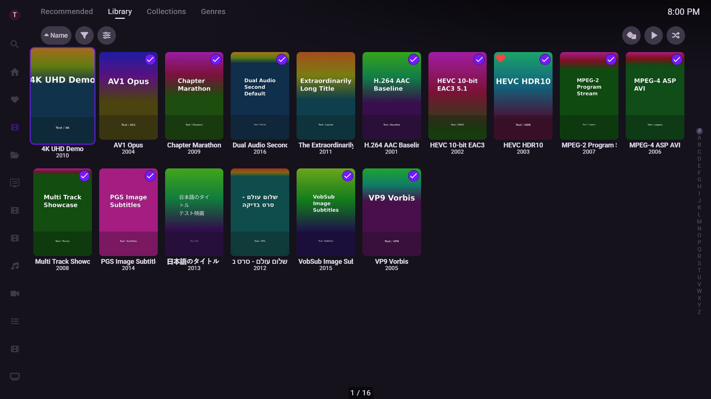
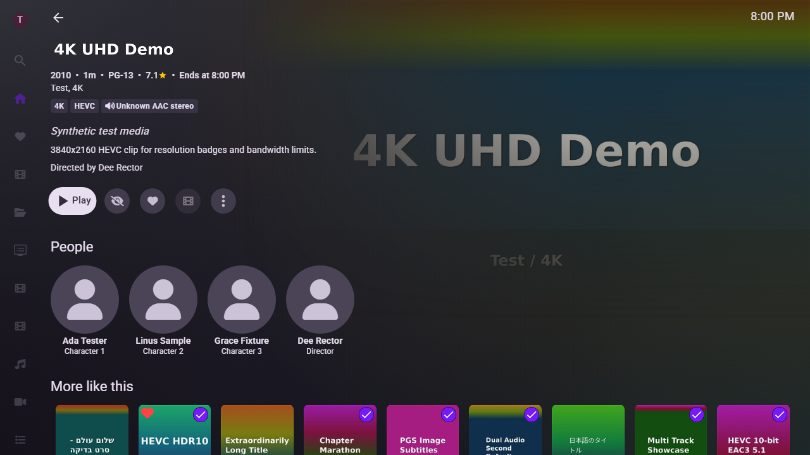
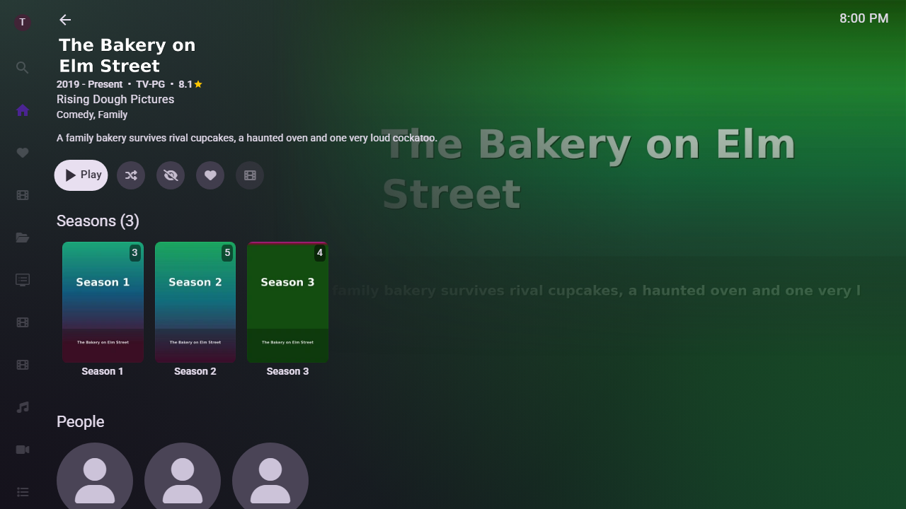
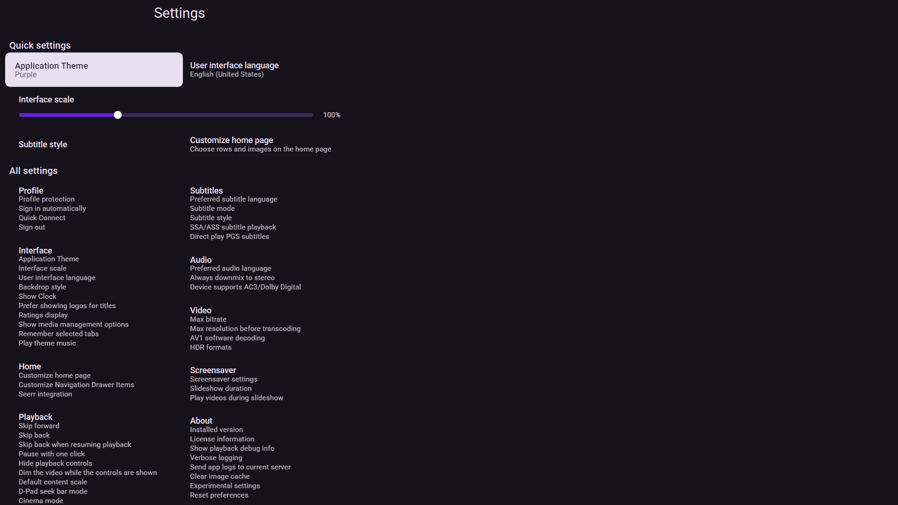
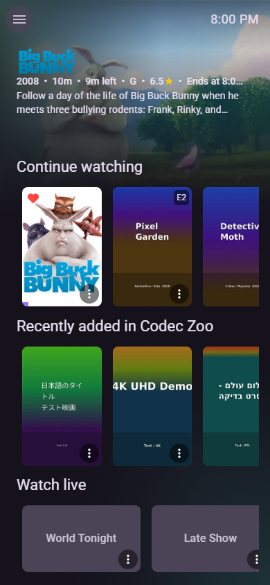

# Wholphin Web

Wholphin Web is a web client for the [Jellyfin](https://jellyfin.org) media server: a browser port of [Wholphin](https://github.com/damontecres/Wholphin), the open-source Android TV client, with the same look, colors, structure and features. It runs beside Jellyfin's own web page, at its own address, and changes nothing on the Jellyfin server: users, libraries and watch history stay in Jellyfin and are shared with every other Jellyfin app. It is open source under GPL-2.0-only.

It is made for desktop browsers first and also works on phones. Safari, iPhone and iPad were never tested (see [Known limits](#supported-browsers-and-known-limits)).

**Unofficial.** This project is not affiliated with, or endorsed by, the author of Wholphin or the Jellyfin project. Please do not report its problems to them. Report them in the [Issues of this repository](https://github.com/NadavM-Eng/wholphin-but-for-web/issues).

## Screenshots

The pictures show a disposable test server with generated and openly licensed media, in the Purple theme.

<table>
  <tr>
    <td><br>Home</td>
    <td><br>Library</td>
    <td><br>Movie page</td>
  </tr>
  <tr>
    <td><br>Series page</td>
    <td><br>Player</td>
    <td><br>Settings</td>
  </tr>
  <tr>
    <td><br>Live TV guide</td>
    <td><br>Album and mini player</td>
    <td align="center"><br>Home on a phone</td>
  </tr>
</table>

## What it does

Sign-in (password or Quick Connect, several servers and users), Home rows, libraries with sorting and filtering, detail pages, search, Live TV, music with a mini player, photos with a slideshow, a screensaver, eight color themes and 41 translations (right-to-left included).

Playback plays a file directly when the browser can, and otherwise lets Jellyfin repackage or re-encode it. It has audio and subtitle selection (ASS and PGS drawn in the browser), intro and outro skipping, Next up, chapters and seek thumbnails. The player keeps its place when the next episode starts, and the Up and Down arrow keys change the volume.

[Seerr](https://github.com/seerr-team/seerr), a separate program for requesting titles that are not in the library, is optional: when one is configured, the app shows the Discover pages. You do not need Seerr.

## Set it up

The app is a static web app plus a small server that hands it out, tells it which Jellyfin server to use, and forwards Seerr requests. No ready-made container image is published: you build one from this repository with the first step below.

**You need:** [Docker](https://docs.docker.com/get-docker/), [git](https://git-scm.com/), and a Jellyfin server that already works (developed and tested against Jellyfin 10.11, see [docs/STATUS.md](docs/STATUS.md)). No Jellyfin setting needs changing: a stock Jellyfin already answers a page served from another address.

1. Get the files and build the image:

   ```bash
   git clone https://github.com/NadavM-Eng/wholphin-but-for-web.git
   cd wholphin-but-for-web
   docker build -t wholphin-web .
   ```

2. Start it. Replace the address with that of the machine that runs Jellyfin, as you type it into a browser, for example `http://192.168.1.10:8096` (for HTTPS use the HTTPS address):

   ```bash
   docker run -d --name wholphin-web --restart unless-stopped \
     -p 8090:8080 \
     -e JELLYFIN_URL=http://192.168.1.10:8096 \
     -e TRUST_PROXY=false \
     wholphin-web
   ```

   `TRUST_PROXY=false` is for opening the app directly, with no reverse proxy in front. In PowerShell, write the command on one line without the backslashes. The browser, not the container, talks to Jellyfin, so the address must work from every device that will open the app; `localhost` works only when the browser runs on the Jellyfin machine itself. Leave out `JELLYFIN_URL` to type the server address in the app instead.

3. Open `http://localhost:8090` (or `http://<address of this machine>:8090` from another device). You should see the users of your Jellyfin server or its sign-in form; sign in with a normal Jellyfin account.

4. Check it: `docker ps` shows "healthy" after about half a minute, and `docker logs wholphin-web` prints the port, the Jellyfin address and whether Seerr is on. A setting that is not a valid address or number stops the container, and the log names it. If sign-in says it cannot connect, open the Jellyfin address in the same browser; if that fails too, the address is wrong for that device.

**Seerr (optional).** Add `-e SEERR_URL=http://host.docker.internal:5055 --add-host host.docker.internal:host-gateway` to the `docker run` command. `host.docker.internal` means the machine that runs Docker; for Seerr in another container on the same Docker network use its name, for example `http://seerr:5055`. Seerr should use the same Jellyfin server.

**Docker Compose** is an alternative to `docker run`; use one or the other, not both at once, because both name the container `wholphin-web`. Copy `docker-compose.example.yml` to `docker-compose.yml`, edit its addresses (remove `SEERR_URL` if you have no Seerr), and run `docker compose up -d --build`. The example publishes the app on `127.0.0.1:8090` only, for use behind a reverse proxy; for direct use remove `127.0.0.1:` from the `ports` line and add `TRUST_PROXY: "false"` under `environment`.

**Update:**
1. `git pull`, then `docker build -t wholphin-web .` again.
2. `docker rm -f wholphin-web`, then the `docker run` command again.

**Remove everything:** `docker rm -f wholphin-web`, then `docker rmi wholphin-web`. Nothing else is stored on the machine; each browser keeps its own sign-in and settings.

### Settings

All are environment variables of the server (`server/config.ts`); none is required. The address settings are read when the app loads, so a change needs a restart, not a new build.

| Variable | What it does | Default |
|---|---|---|
| `JELLYFIN_URL` | Address at which browsers reach Jellyfin. When set, the app is locked to that server. When unset, people add a server by typing its address. | unset |
| `SEERR_URL` | Address at which this server reaches Seerr. When set, Discover works through `/seerr-proxy`. | unset (Seerr off) |
| `SERVER_NAME` | A name shown before the Jellyfin server answers. | unset |
| `PORT`, `HOST` | Port and address to listen on. | `8080`, `0.0.0.0` |
| `TRUST_PROXY` | Believe the `X-Forwarded-*` headers of a reverse proxy. Choose `false` for direct use; keep `true` only behind a reverse proxy. | `true` |
| `HSTS` | Send `Strict-Transport-Security` on HTTPS requests. | `true` |
| `CSP_EXTRA_ORIGINS` | Extra origins (space or comma separated) the page may connect to, for example a second Jellyfin address. | none |
| `MAX_BODY_MB`, `SEERR_TIMEOUT_SECONDS` | Size and time limits of the Seerr proxy. | `10`, `30` |
| `ACCESS_LOG` | Log one line per request (paths only). | `false` |
| `DIST_DIR` | Folder with the built app. The image sets it. | the `dist` folder next to `server/` |

`GET /healthz` answers `{"status":"ok"}`; the image's health check uses it.

### Behind a reverse proxy (HTTPS)

To use the app from outside your home, put it behind a reverse proxy that adds HTTPS. Publish the container on the local machine only (`-p 127.0.0.1:8090:8080`), leave `TRUST_PROXY` at its default, and give `JELLYFIN_URL` as an HTTPS address, because a page opened over HTTPS may not call an HTTP one. A Caddy site is two lines (`reverse_proxy 127.0.0.1:8090` inside a block for your host name). The app must be served at the root of a host name or port, not under a sub-path. [docs/deploy.md](docs/deploy.md) has the Caddy and nginx examples, a variant on a separate port, and notes on cookies. Those examples were not all run by the project.

### Is it safe on the internet?

Sign-in is Jellyfin's own: the app has no accounts of its own and stores nothing on its server (servers, tokens and preferences stay in each browser). Reaching it from outside needs HTTPS through a reverse proxy, as [SECURITY.md](SECURITY.md) advises. The browser talks to Jellyfin directly, so the app exposes nothing that Jellyfin does not already expose to a signed-in user; only Seerr goes through the app's server, at `/seerr-proxy`. No independent security review is recorded in the documents.

## How it differs from the TV app

- The layout is fluid, not a fixed TV screen.
- The "focused" look appears on mouse hover as well as on keyboard focus; arrow keys move focus like a remote's D-pad.
- The browser's Back replaces the remote's Back button; right-click, the Menu key or a long press on touch replaces the remote's long press.
- There is one player, built on the browser's video element, with volume, fullscreen, picture-in-picture and keyboard shortcuts added.
- Settings has a new order: a few quick settings, then every setting under its subject.

Every difference, with its reason, is in [docs/DEVIATIONS.md](docs/DEVIATIONS.md).

## Run it from source

For developers. You need Node 24 (the version in `.nvmrc`) and npm.

```bash
npm ci
npm run dev        # the app on http://localhost:5173
```

The app opens on the "add server" screen. An optional, git-ignored `.env.local` holds local settings: `DEV_SEERR_URL` makes the dev server forward `/seerr-proxy` to a Seerr, and `TEST_JELLYFIN_URL`, `TEST_JELLYFIN_USER` and `TEST_JELLYFIN_PASSWORD` let the development-only page `/dev/login` sign in without typing. Never commit this file. `npm run ts:up` starts a disposable Jellyfin in Docker for tests ([docs/TOOLING.md](docs/TOOLING.md)).

To run the production server without Docker: `npm ci`, `npm run build`, `npm start`, with the settings above.

Before a pull request run `npm run typecheck`, `npm run test`, `npm run lint` and `npm run build`; CI runs these and also type-checks the tests (`npm run e2e:typecheck`). The end-to-end suite is `npm run e2e`. See [CONTRIBUTING.md](CONTRIBUTING.md).

## Supported browsers and known limits

| Browser | Minimum version |
|---|---|
| Chrome and Edge | 119 |
| Firefox | 128 |
| Safari | 16.4 |

An older browser shows a notice in place of the app. The minimum versions come from reading the code against browser support tables.

- Formats the browser cannot play are remuxed or transcoded by the server, so a film still plays but costs the server more work.
- Never tested: Safari itself, any iPhone or iPad, the oldest supported versions above, HDR output, hardware HEVC decoding, and a real microphone for voice search. Touch was mostly emulated in the checks; a real phone was tried once. Playback was tested in headless Edge and Chrome; Firefox and WebKit ran a smaller set of tests.
- Not possible in a browser: finding servers on the local network, switching the display's refresh rate, passing surround sound through undecoded, an audio delay control, the Android TV launcher's "Watch Next" row.
- Not built: remote control of this app from another Jellyfin client; translations of the texts that exist only in the web app (they stay English); DVD and DVB subtitles drawn in the browser (the server burns them in).
- Built but never tested against a real server: creating and cancelling Live TV recordings, a completed subtitle download, saving Home rows to the Jellyfin server, and signing in to Seerr as a local Seerr user or with an API key.
- Video playback was not re-checked in the Docker image as it stands now, and the nginx example of the deployment guide was never run.

## Status

Every planned feature of the TV app's scope is built. The project is in maintenance: changes are made one at a time, desktop browser first, with phones and touch after. [docs/STATUS.md](docs/STATUS.md) has the detailed record of what works, how it was checked and what was not.

## How it was built

Wholphin Web was written by AI coding agents (Claude, made by Anthropic) under the direction of the repository owner, working from Wholphin's source code. The record, including mistakes and what was never verified, is in [docs/PROJECT-LOG.md](docs/PROJECT-LOG.md).

## Documentation

| Document | Contents |
|---|---|
| [docs/STATUS.md](docs/STATUS.md) | What works, how it was checked, known problems. |
| [docs/deploy.md](docs/deploy.md) | The deployment guide. |
| [docs/DEVIATIONS.md](docs/DEVIATIONS.md) | Every difference from the TV app. |
| [docs/ARCHITECTURE.md](docs/ARCHITECTURE.md) | How the code is organized. |
| [CONTRIBUTING.md](CONTRIBUTING.md) | How to contribute. |

The full set, with a reading order, is indexed in [docs/README.md](docs/README.md).

## Credits

- [Wholphin](https://github.com/damontecres/Wholphin) by [damontecres](https://github.com/damontecres) and its contributors. The design, behavior, interface texts and translations come from it.
- [Jellyfin](https://jellyfin.org), the media server, and its TypeScript SDK; [Seerr](https://github.com/seerr-team/seerr), the request manager.
- The main libraries: React, React Router, TanStack Query and Virtual, Zustand, i18next, [hls.js](https://github.com/video-dev/hls.js), [JASSUB](https://github.com/ThaUnknown/jassub), Hono, Vite, Vitest and Playwright.
- The film pictures in the screenshots come from open movies of the Blender Foundation; the rest is generated test media.

## Licence

GPL-2.0-only, the same as Wholphin ([LICENSE](LICENSE)), with one added permission for three Apache-2.0 components in [LICENSE-EXCEPTION.md](LICENSE-EXCEPTION.md). Every shipped component is listed in [THIRD-PARTY-NOTICES.md](THIRD-PARTY-NOTICES.md).
