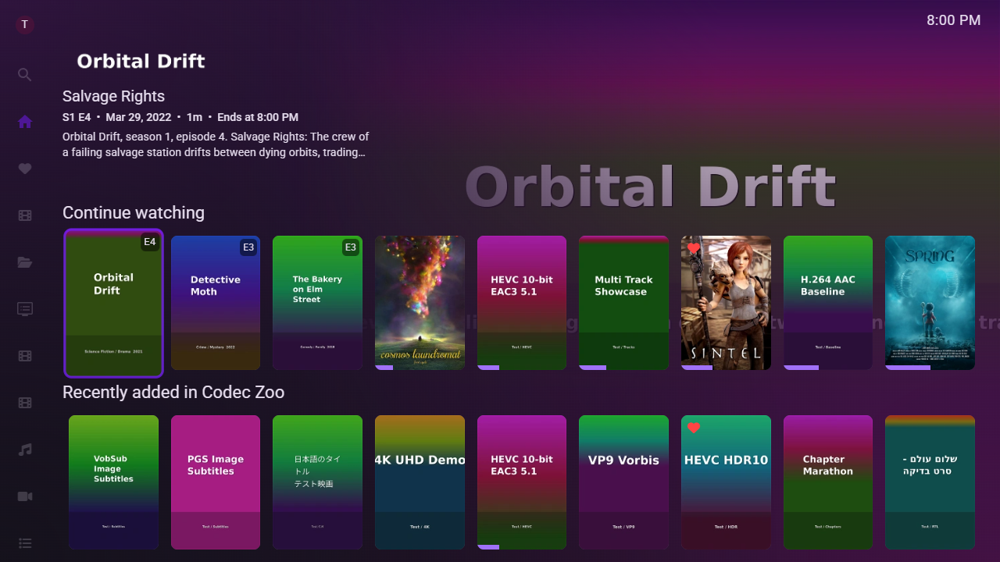
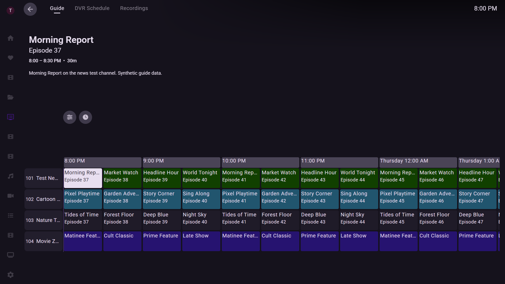
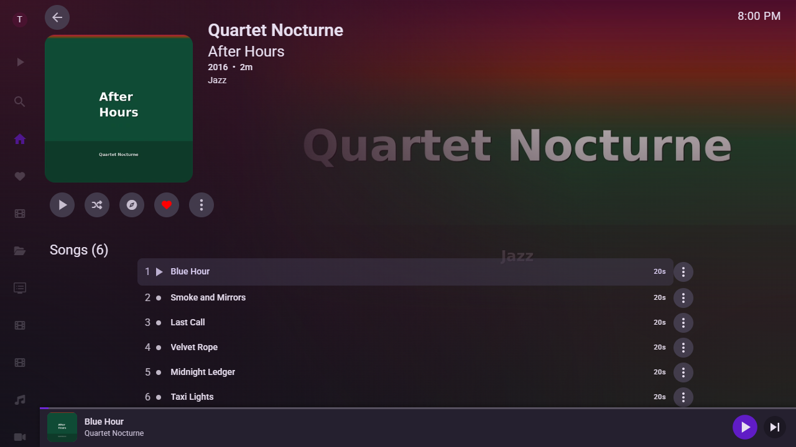

# Wholphin Web

Wholphin Web is a web port of [Wholphin](https://github.com/damontecres/Wholphin), the open-source Android TV client for the [Jellyfin](https://jellyfin.org) media server. It aims for the same look, colors, page structure and features as the TV app, in a browser: it is driven by mouse, keyboard or touch, and its layout fills the window, from a phone to an ultrawide monitor, where the TV app draws a fixed TV screen. It is a front end only. Your films, shows, music and photos stay on your own Jellyfin server.

**Unofficial.** This project is not affiliated with, or endorsed by, the author of Wholphin or the Jellyfin project. Please do not report its problems to them.

**Status: first public release.** Since the documents below were last brought up to date, the video player got a compact layout (no dimming of the picture, one low control strip, chapters and queue as panels) and plays much more without the server converting: Matroska files directly in Chromium-based browsers, PGS subtitles drawn in the browser. The documents in [docs/](docs/) describe the state just before those two changes; commit hashes named in them refer to the development history, which is not part of this repository. Every planned feature is built, and all of it is on the `main` branch, including a screen-by-screen comparison with 244 pictures of the TV app taken in an Android TV emulator, a final round in which independent checkers examined the app and their findings were repaired, a polishing round for most of the minor points that were left, and two small fixes after it: one for numbers and units in right-to-left languages, one for scrolling with a finger over a slider. In the recorded runs on the current code the app passed its type checks, its 776 unit tests and all 250 end-to-end tests in Chromium, Firefox and WebKit; the last screenshot crawl, in English and in Hebrew, was taken before those two fixes and reported no page errors and no warnings. The results are in [docs/STATUS.md](docs/STATUS.md). All of these ran against a disposable test server, without a visible browser window, and the crawl used one color theme at a desktop and a phone window size. Never tested in the project's own checks: Safari itself and any iPhone or iPad, the oldest supported Chrome and Firefox versions, HDR output, and hardware HEVC decoding, which cannot be tested without a visible window. Touch was emulated in every one of those checks; the only real touch device so far was one phone, in the trial described below, and which phone and browser it was is not recorded. These and the other unverified points are listed under [Not there (yet)](#not-there-yet) and [Supported browsers](#supported-browsers). Still open: the features listed there as not built, a closer look at phones and touch after the desktop version, and translations of the texts that exist only in the web app.

The automatic checks that GitHub runs on every push (type checks, unit tests, lint, the build and an image build) passed on the current code. A container image built from that code was tried behind a reverse proxy with HTTPS, against a real Jellyfin: a check through the proxy loaded the app, signed in, opened Home and an item page and reached Seerr through the app's server, with no violation of the page's security policy, and a first manual test on a phone found that everything worked. No video was played in that check, and the trial was one person's first test, not a release. The record of what was done and checked is in [docs/PROJECT-LOG.md](docs/PROJECT-LOG.md).

## Screenshots

The pictures come from the project's screenshot crawler, in the Purple theme. They show a disposable test server that holds only generated test media and openly licensed films, so the titles, people and channels in them are made up. There is no picture of the Discover pages, because they could only be photographed with content on a real server.

<table>
  <tr>
    <td><br>Home</td>
    <td><br>Library</td>
    <td><br>Movie page</td>
  </tr>
  <tr>
    <td><br>Series page</td>
    <td><br>Player</td>
    <td><br>Settings</td>
  </tr>
  <tr>
    <td><br>Live TV guide</td>
    <td><br>Album and mini player</td>
    <td align="center"><br>Home on a phone</td>
  </tr>
</table>

## What it does

The features follow the TV app area by area.

- **Sign-in.** Several servers and several users per server, sign-in by password or by Quick Connect (Jellyfin's way of approving a new device from one that is already signed in), and an optional PIN on a user profile. The PIN is a convenience lock, as in the TV app: it is kept in this browser's storage as plain text and does not replace the Jellyfin password.
- **Home.** The Home rows of the TV app (Continue watching, Next up, recently added, favorites, genres, Live TV and others) and the screen that customizes them. Row settings use the TV app's format and are kept in the browser. The screen can also save them to the Jellyfin server, where the TV app keeps its own; saving to and loading from the server was never verified.
- **Libraries.** Tabs per library type, grids with sorting, filtering and view options, a letter bar for jumping, Favorites, collections and playlists.
- **Detail pages.** Movie, series, season and episode, box set, playlist and person pages, with the same buttons and context menus as the TV app, including the choice of version, audio track and subtitle track before playing.
- **Search.** Search as you type, with result types you can switch on and off. A voice search button appears where the browser has speech recognition; real speech input was never tested (see [Supported browsers](#supported-browsers)).
- **Playback.** The browser plays a file directly when it can. When it cannot, Jellyfin repackages the file without re-encoding it (a remux), and only as a last step re-encodes it (a transcode). The player has audio and subtitle track selection, styled text subtitles, ASS subtitles drawn in the browser, image subtitles (PGS, VobSub) burned into the picture by the server, skipping of intros and outros, the Next up panel, chapters, preview thumbnails on the seek bar (trickplay), playback speed and subtitle delay.
- **Seerr.** [Seerr](https://github.com/seerr-team/seerr) is a separate program for requesting titles that are not in the library yet. When the deployment has one, the app shows the TV app's Discover pages and lets a user request a movie or seasons of a show and cancel their own request.
- **Live TV.** The program guide, the program and channel dialogs, the recording schedule and the recordings.
- **Music.** Albums, artists, songs, genres and playlists, a play queue, a Now Playing page with synced lyrics, and a mini player bar that stays visible while you browse.
- **Photos.** Photo libraries and albums, and a slideshow viewer with zoom, rotation and video clips.
- **Screensaver.** The in-app screensaver after a period without input.
- **Themes and languages.** The TV app's eight color themes, and its interface texts in English and the TV app's 41 translations, with right-to-left layout for Hebrew and Arabic. Texts that exist only in the web app are English in every language (see below).

### Different from the TV app on purpose

- The layout is fluid, not a fixed TV canvas: rows scroll sideways, grids reflow, pages scroll.
- The TV app's "focused" look appears on mouse hover as well as on keyboard focus, and only one element shows it at a time. Arrow keys move focus as a remote's D-pad does.
- The browser's Back replaces the remote's Back button. A right-click, the Menu key or a long press on touch replaces the remote's long press.
- There is one player, built on the browser's own video element. The TV app's choice of player backends (ExoPlayer, MPV, an external player) has no equivalent.
- The player adds what a TV gets from its hardware: volume and mute, fullscreen, picture-in-picture and keyboard shortcuts. Music adds the mini player bar.
- Seerr is reached through the app's own server, so users do not type a Seerr address.

Every difference, with its reason and the file that implements it, is listed in [docs/DEVIATIONS.md](docs/DEVIATIONS.md). That document also lists the upstream bugs that were fixed and not copied.

### Not there (yet)

Left out because a browser cannot do it: finding servers on the local network, switching the display's refresh rate, passing surround sound through undecoded, an audio delay control, the Android TV launcher's "Watch Next" row, and in-app updates.

Not built:

- Remote control of this app from another Jellyfin client, because the app keeps no live connection to the server.
- Translations of the 183 texts that exist only in the web app. They stay English in every language.
- Filter and full view options on the music grids, and Play for an album or artist in the shared context menu.
- Drawing image subtitles (PGS, VobSub) in the browser. The server burns them into the picture instead, which costs a transcode.
- Opening the program dialog from a Live TV program in search results. The card plays its channel.

Built, but known to be incomplete:

- The two "image subtitle opacity" settings are shown and have no effect, because image subtitles are burned in by the server.
- Opening a Discover page directly by its address highlights Home, not Discover, in the navigation drawer.

Built but never verified:

- Creating or cancelling a Live TV recording against a real server. Those actions were only run against simulated server answers, because a test recording once filled a disk.
- A subtitle download that completes.
- HDR output on an HDR display, hardware HEVC decoding, and Dolby Vision.
- Voice search with a real microphone. Only its logic was tested, with a simulated recognizer. The production server's `Permissions-Policy` header allows the microphone for the app's own origin only (`microphone=(self)`), so voice search is not blocked there; with a real microphone this was not tested either.
- Home rows saved to or loaded from the Jellyfin server, and Home rows supplied by the TV app's optional server plugin.
- Seerr through the production server. Only Seerr's status and one sign-in were exercised through its proxy; browsing and requesting ran through the development server's proxy. Signing in to Seerr as a local Seerr user or with an API key was not exercised against a real Seerr.
- Right-to-left layout on several screens.
- Real phones and tablets beyond one person's first test on a phone (touch was emulated in every automated check), TV browsers, and the browsers named in the next section.
- The reverse-proxy examples of the deployment guide as written. The app runs behind Caddy with HTTPS in a trial, but its route was added to an already running Caddy by hand, not from the guide's site blocks; the nginx example was never run.
- Video playback in the Docker image of the app exactly as it stands now. An image built from the current code was signed in to and browsed through a reverse proxy; the last time a container played a clip, it was built from the code of the final repair, before the later fixes. A build from a completely fresh copy of the repository was never run either.

## Supported browsers

| Browser | Minimum version |
|---|---|
| Chrome and Edge | 119 |
| Firefox | 128 |
| Safari | 16.4 |

The stylesheets need CSS features that older versions lack. An older browser shows a notice in place of the app.

Two things depend on the browser and not on the app:

- **Codecs.** The app asks the browser which video and audio formats it can play and tells Jellyfin. Anything the browser cannot play is remuxed or transcoded by the server, so a film still plays but costs the server more work.
- **Voice search.** It uses the browser's speech recognition and needs a page opened over HTTPS. The code looks for the recognizer that Chromium browsers and Safari provide; where a browser has none (Firefox, at the time of writing), the voice button is not offered. See also the note on voice search under [Not there (yet)](#not-there-yet).

What was tested, and where:

- All development and most testing used the Chromium build that the Playwright test tool ships. Playback was tested in headless Microsoft Edge and Google Chrome, because they contain the real codecs.
- The end-to-end suite runs a subset of its tests in Playwright's Firefox build and in Playwright's WebKit build. WebKit is the engine inside Safari. The subset covers sign-in, Home, a library, the movie and series pages, search, menus, a theme change, Hebrew, and one short test each for settings, music, photos, Live TV and playing an H.264 clip. Subtitles, track switching, Seerr and most of the player were exercised in Chromium, Edge and Chrome only. The WebKit build used for testing has no support for HLS streams, so only direct play could be tried in it; remuxed and transcoded playback in WebKit was not tested.
- Everything ran without a visible window on Windows, against Jellyfin 10.11.
- Never tested in the project's own checks: Safari itself on macOS, any browser on an iPhone or iPad, and the minimum versions in the table. The minimum versions come from reading the code against browser support tables. The one use on a real device so far is a first test on a phone, whose model and browser are not recorded.

## Run it

Wholphin Web is a static web app plus a small server that hands out the app, tells it which Jellyfin server to use, and forwards Seerr requests. The full guide is [docs/deploy.md](docs/deploy.md). The app must be served at the root of a host name or port. It cannot live under a sub-path such as `/wholphin/`.

### With Docker

You need Docker, a copy of this repository, and a Jellyfin server that already works. No image is published, so the first step builds one. Run the commands in the repository's folder.

```bash
docker build -t wholphin-web .
docker run -d --name wholphin-web --restart unless-stopped \
  -p 8090:8080 \
  -e JELLYFIN_URL=http://jellyfin.example.org:8096 \
  -e TRUST_PROXY=false \
  wholphin-web
```

The commands are written for a POSIX shell. In PowerShell, write the `docker run` command on one line without the backslashes.

Replace `http://jellyfin.example.org:8096` with the address of your own Jellyfin server, exactly as you type it into a browser to open Jellyfin. Three things to know about that address:

- **The visitor's browser uses it, not the container.** It must work from every device that will open Wholphin Web. `localhost` works only for a browser on the machine that runs Jellyfin.
- **Leave `JELLYFIN_URL` out** if you would rather type the server address in the app. The app then starts on an "add server" screen and can hold several servers.
- **HTTPS needs HTTPS.** If people open Wholphin Web over HTTPS, the Jellyfin address must be an HTTPS address too (see the next section).

Then open `http://localhost:8090` on the same machine, or `http://<name-or-address-of-that-machine>:8090` from another device on your network. You should see the users of your Jellyfin server, or its sign-in form. Sign in with a normal Jellyfin account.

To check the container:

```bash
docker ps                    # the STATUS column shows "healthy" within about half a minute
docker logs wholphin-web     # prints the port, the Jellyfin address and whether the Seerr proxy is on
```

If the sign-in screen reports that it cannot connect, open the Jellyfin address in the same browser first; if that fails too, the address is wrong for that device. A setting that is not a valid address or number stops the container at start, and `docker logs wholphin-web` names the variable.

To add Seerr, add these two lines to the `docker run` command, before its last line. `SEERR_URL` is the address at which the container can reach Seerr; with Seerr on the same machine that is usually:

```bash
  -e SEERR_URL=http://host.docker.internal:5055 \
  --add-host host.docker.internal:host-gateway \
```

`host.docker.internal` is the name by which a container reaches the machine it runs on. Docker Desktop provides it; on Linux the `--add-host` line does. If Seerr runs in a container on the same Docker network, use that container's name instead, for example `http://seerr:5055`. Seerr should be connected to the same Jellyfin server, so that people can sign in to it with their Jellyfin account.

To change a setting, remove the container and run it again with the new values (`docker rm -f wholphin-web`, then the `docker run` command). To update after fetching a newer copy of the repository, run `docker build` again first. The container keeps no data, so nothing is lost; each browser keeps its own sign-in and settings.

With Docker Compose, copy `docker-compose.example.yml` to `docker-compose.yml`, edit the two addresses, and run `docker compose up -d --build`. That example publishes the app on the local machine only (`127.0.0.1:8090`), which suits the reverse-proxy setup below. To use it without a proxy, remove `127.0.0.1:` from its `ports` line and add `TRUST_PROXY: "false"` under `environment`.

The settings are environment variables. All are optional.

| Variable | Meaning |
|---|---|
| `JELLYFIN_URL` | The address at which browsers reach Jellyfin. When set, the app is locked to that server and opens on its sign-in screen. When unset, people add a server by typing its address. |
| `SEERR_URL` | The address at which this server reaches Seerr. It may be an internal address. When set, Discover is available through the path `/seerr-proxy`. When unset, Seerr is off. |
| `SERVER_NAME` | A name shown before the Jellyfin server answers. |
| `PORT`, `HOST` | The port and address to listen on. The defaults are `8080` and `0.0.0.0`. |
| `TRUST_PROXY` | Whether to believe the `X-Forwarded-*` headers of a reverse proxy. The default is `true`. Set it to `false` when no proxy is in front, because otherwise any visitor can send those headers. |

[docs/deploy.md](docs/deploy.md) describes the remaining variables (`HSTS`, `CSP_EXTRA_ORIGINS`, `MAX_BODY_MB`, `SEERR_TIMEOUT_SECONDS`, `ACCESS_LOG`, `DIST_DIR`). The app reads its settings from `GET /config.json` when it loads, so a change needs a restart of the container and not a rebuild of the image. `GET /healthz` answers `{"status":"ok"}`, and the image's health check uses it.

### Behind a reverse proxy

To reach the app from outside your home, put it behind a reverse proxy that adds HTTPS, next to Jellyfin. Publish the container on the local machine only, and leave `TRUST_PROXY` at its default (the two Seerr lines from above can be added in the same way):

```bash
docker run -d --name wholphin-web --restart unless-stopped \
  -p 127.0.0.1:8090:8080 \
  -e JELLYFIN_URL=https://media.example.org \
  wholphin-web
```

A [Caddy](https://caddyserver.com) site for it looks like this, where `wholphin.example.org` stands for a host name of your own that points at the machine:

```caddy
wholphin.example.org {
    encode zstd gzip
    reverse_proxy 127.0.0.1:8090
}
```

A page loaded over HTTPS may not call an HTTP address, so `JELLYFIN_URL` must then be the HTTPS address of your Jellyfin (`https://media.example.org` in the example). [docs/deploy.md](docs/deploy.md) has the variant on a separate port, the variant for a setup where no second port can be opened, an nginx example and the notes on cookies. The project's own trial runs behind Caddy on a sub-name, with a route added by hand; the site blocks as written here and the nginx example have not been run by the project.

### From source, for development

You need Node 24 (the version in `.nvmrc`) and npm.

```bash
npm ci
npm run dev        # the app on http://localhost:5173
```

The app opens on the "add server" screen, where you type the address of a Jellyfin server. To run the production server without Docker, run `npm ci`, `npm run build` and then `npm start`, with the same environment variables as above. It listens on port 8080 unless `PORT` says otherwise.

An optional, git-ignored file `.env.local` holds local settings for development. `DEV_SEERR_URL` makes the dev server forward `/seerr-proxy` to a Seerr. `TEST_JELLYFIN_URL`, `TEST_JELLYFIN_USER` and `TEST_JELLYFIN_PASSWORD` let the development-only page `/dev/login` sign in without typing. The `TESTSRV_*` keys are written by the script that sets up a disposable Jellyfin in Docker for the tests (`node tools/testserver/setup.mjs`; [docs/TOOLING.md](docs/TOOLING.md) has the steps). Never commit this file.

## How it relates to your Jellyfin server

- **It is only a front end.** It has no media, no database and no accounts of its own. People sign in with their normal Jellyfin accounts.
- **The browser talks to Jellyfin directly.** The app's server does not carry the API calls, the images or the video. The code needs three things: an address for Jellyfin that the user's browser can reach; an HTTPS address when the app itself is opened over HTTPS; and a Jellyfin that answers requests coming from a page on another address (cross-origin requests). A stock Jellyfin 10.11 does: the project's disposable test server answered such requests with no setting changed for it. A reverse proxy in front of Jellyfin that removes or rewrites those answers' cross-origin headers would presumably break the app; no such setup was tried.
- **Seerr goes through the app's own server.** Seerr does not answer cross-origin requests and keeps its sign-in in a cookie, so the browser calls `/seerr-proxy` on the app's address and the server forwards the call to the one Seerr named in `SEERR_URL`. Only Seerr's API and its image paths are forwarded, not its web interface.
- **Nothing is stored outside your browser and your servers.** The app keeps the list of servers and users, the session tokens, the preferences, the Home row settings, the drawer pins, the sort and view options and the remembered track choices in the browser's storage, so they belong to one browser and do not follow a user to another device. The Seerr sign-in is a session cookie on the app's address; the Seerr password is never stored, and a Seerr API key, if someone links Seerr with one, is kept for the open tab only. Watched state, resume points and favorites are stored by Jellyfin, as with any client. The project runs no service of its own and collects nothing.

## Development and project documents

| Document | Contents |
|---|---|
| [docs/README.md](docs/README.md) | The index of the documentation, with a reading order and a glossary. |
| [docs/ARCHITECTURE.md](docs/ARCHITECTURE.md) | How the code is organized. |
| [docs/TOOLING.md](docs/TOOLING.md) | The commands, the generators and the test tools. |
| [docs/DEVIATIONS.md](docs/DEVIATIONS.md) | Every difference from the TV app: adapted, not ported, upstream bugs fixed, web-only additions. |
| [docs/DECISIONS.md](docs/DECISIONS.md) | Who decided what, and why. |
| [docs/PROJECT-LOG.md](docs/PROJECT-LOG.md) | What was done, in order, with what was and was not verified. |
| [docs/STATUS.md](docs/STATUS.md) | What works, route by route, how each part was checked, the known bugs, and the latest test results. |
| [docs/spec/](docs/spec/) | The behavior of the TV app, written down from its source code. |
| [docs/deploy.md](docs/deploy.md) | The deployment guide. |
| [CONTRIBUTING.md](CONTRIBUTING.md) | How to set up, the conventions, and the checks to run before a pull request. |
| [SECURITY.md](SECURITY.md) | How to report a vulnerability. |
| [CLAUDE.md](CLAUDE.md) | The working agreement that every contributor, human or AI, follows. |

The test tools are these. Unit tests cover the logic (`npm run test`), and an end-to-end suite drives the running app in Chromium, Firefox and WebKit against a disposable Jellyfin (`npm run e2e`, described in [e2e/README.md](e2e/README.md)). A screenshot crawler photographs every page in several window sizes and all eight themes and reports page errors (`npm run shots`), and it can place the web app, laid out on the TV's own screen size, next to each of the reference pictures taken from the TV app in an Android TV emulator (`npm run shots:compare`, described in [tools/shots/README.md](tools/shots/README.md)).

## How it was built

Wholphin Web was written by AI coding agents (Claude, made by Anthropic) under the direction of the repository owner, who made the product decisions. The agents worked from the source code of Wholphin: they first wrote its behavior down as specifications, then built the app in stages, with separate agents reviewing and correcting each stage. The record, including the mistakes and what was never verified, is in [docs/PROJECT-LOG.md](docs/PROJECT-LOG.md).

## Credits

- [Wholphin](https://github.com/damontecres/Wholphin) by [damontecres](https://github.com/damontecres) and its contributors. The design, the behavior, the interface texts and their translations come from it. This port follows Wholphin's source at upstream commit `8dcf189`; the TV app that was photographed for comparison is release 1.1.1.
- [Jellyfin](https://jellyfin.org), the media server, and its TypeScript SDK.
- [Seerr](https://github.com/seerr-team/seerr), the request manager.
- The main libraries: React, React Router, TanStack Query and TanStack Virtual, Zustand, i18next, [hls.js](https://github.com/video-dev/hls.js) for HLS video streams, [JASSUB](https://github.com/ThaUnknown/jassub) for ASS subtitles, Hono for the server, Vite, Vitest and Playwright.
- The films in the screenshots are open movies of the Blender Foundation.

## Licence

Wholphin Web is licensed under the GNU General Public License, version 2 only (GPL-2.0-only), the same licence as Wholphin. The text is in [LICENSE](LICENSE).

[LICENSE-EXCEPTION.md](LICENSE-EXCEPTION.md) adds one permission. Three of the components that ship with the app (hls.js, abslink and the Material Design icon shapes) are under the Apache License 2.0, which the Free Software Foundation considers incompatible with version 2 of the GPL. Wholphin itself is distributed with Apache-2.0 libraries (for example AndroidX, Jetpack Compose and Media3/ExoPlayer), so the port is in the same position as the original. The project keeps these libraries, and the exception states openly that the contributors to Wholphin Web permit combining the code they wrote with them. It does not and cannot change the terms of the parts derived from Wholphin, which remain under Wholphin's GPL version 2. The file is a statement of the project's licensing intent, not legal advice.

One dependency was replaced for licence reasons. JASSUB depends on a package named `rvfc-polyfill` that is published under GPL-3.0, which is incompatible with GPL-2.0-only in a way no exception of this project could fix. The project therefore ships its own small stand-in in `vendor/rvfc-polyfill`.

[THIRD-PARTY-NOTICES.md](THIRD-PARTY-NOTICES.md) lists every component that ships with the app, grouped by licence. The License page inside the app shows the same list.
